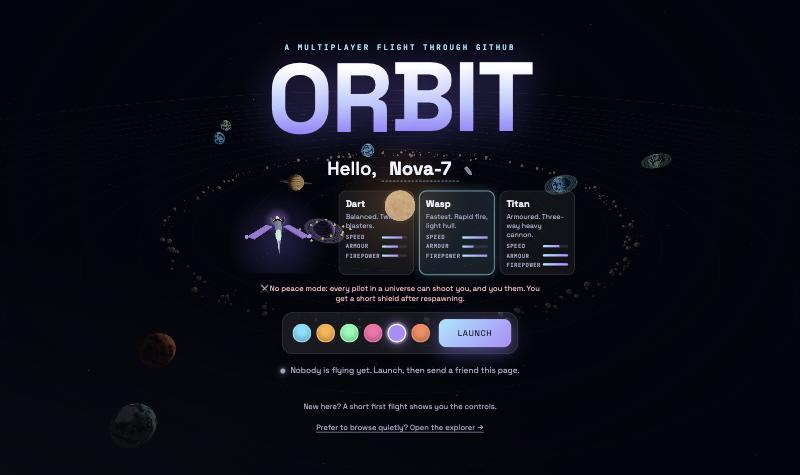
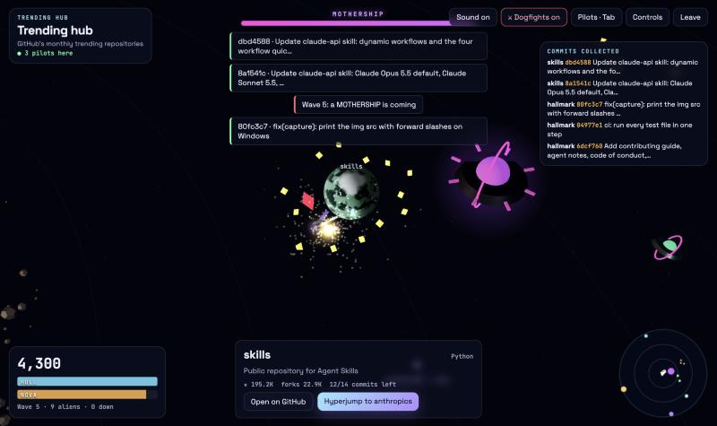
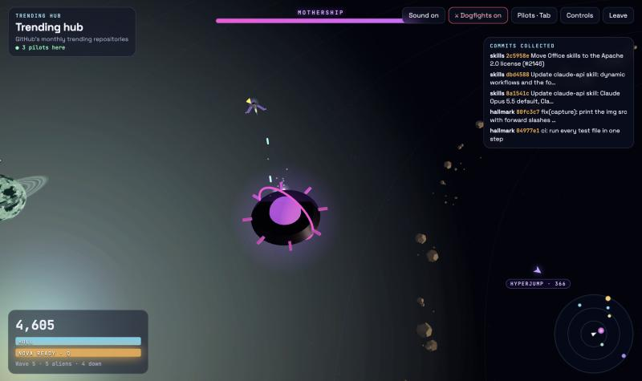
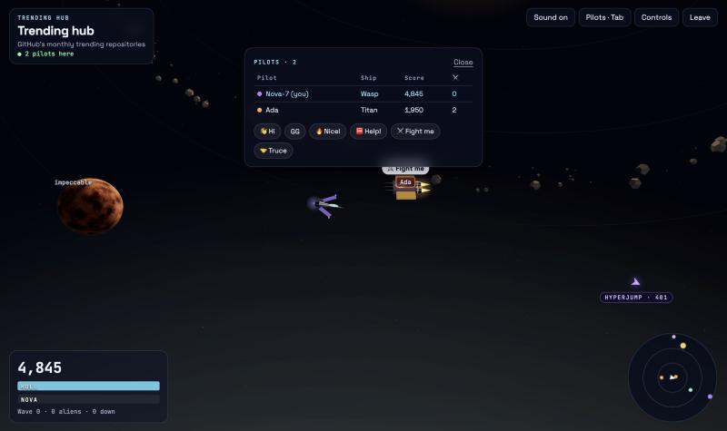

# codeverse

### Fly through GitHub, together.



> Repositories are planets, recent commits are satellites you collect, and every GitHub account is
> a universe. Launch into the trending hub, find the hyperjump gate on the outer rim, type any
> username, and warp into their universe, with whoever else is flying there.

*Why a game:* the earlier CodeVerse explorer turned GitHub into a planetary system you could look
at. Looking is passive and solo. The same real data gets more interesting when it is a place you
fly through, where you can grab a repository and throw it, and where other people are flying too.

**Status: live and multiplayer, on free hosting.** **[Play it at codeverse-orbit.vercel.app](https://codeverse-orbit.vercel.app).**
All-time and daily leaderboards checked by the relay, settings for graphics, colour-blind colours and keys, a two-second hyperjump tunnel,
planet docking with contributor hyperjumps, meteor storms, bounties, a hold-the-gate zone and a
daily challenge, planets that behave by language with issue asteroids and star shields, three ships, four alien types with a boss every fifth wave, a gravity beam, commit-charged
supernovas, dogfights between every pilot with a kill feed, a pilots board, emotes, pings,
invite links, tilt-to-steer on phones, gamepad support, generated music, damage numbers, full screen on laptops and phones, a hyperjump gate that moves,
and a comet that links to the creator. The website is on Vercel; the multiplayer relay is on Render,
kept warm during waking hours in India. The original explorer is still at
[`/explorer/`](https://codeverse-orbit.vercel.app/explorer/).

**117 tests in `viewer/`, no network calls.** New here? **[`docs/01-getting-started.md`](docs/01-getting-started.md)**.
Full design record in [`docs/`](docs/README.md); everything the build got wrong on the way is in
[`docs/10-implementation-notes.md`](docs/10-implementation-notes.md); everything *not* done, and
whether that was a constraint or a choice, is in [`REMAINING.md`](REMAINING.md).

```console
$ cd viewer && npm install --legacy-peer-deps
$ npm run dev                                   # game at :5173, explorer at :5173/explorer/, relay included
$ npm test                                      # 117 tests, no network
$ npm run build && npm start                    # production server with the relay on :4173
$ npm run relay                                 # the relay on its own (what Render runs)
$ npm run check:relay -- https://codeverse-relay.onrender.com   # test a deployed relay end to end
```

| | |
|---|---|
|  |  |
| **Commits are real.** Each gold satellite is one of the planet's recent commits; flying through it collects it and charges the supernova. | **Every fifth wave, a mothership.** It rings the area with fire and launches swarmers; planets and novas only chip it. |



**Other pilots are really there.** The pilots board (Tab) lists everyone in the universe with ship, score
and dogfight wins; emotes appear above ships for everyone.

## The universe is real data

Every universe is built from GitHub's public API on the fly. The trending hub is GitHub's monthly
trending page; any other universe is one account's public, non-fork repositories, ranked by
importance, up to 18 planets. Palette and surface come from the language, size from repository size
or stars, and a planet's satellites are its 14 most recent commits, loaded the first time you fly
close. The planets are the explorer's shader worlds, lit from the central sun.

## The simulation owns the rules

`viewer/src/game/sim.ts` is a plain module with no React and no three.js: ships, aliens, bullets,
planets, the gate, the comet, supernovas and dogfights. The 3D scene reads it every frame and draws
it with instanced meshes; the UI samples it ten times a second. Because it is plain code, the rules
run identically in the browser and in Node, and the 13 simulation tests exercise the real thing
rather than a mock of it.

## Multiplayer without a game server

The relay (`viewer/server/multiplayer.mjs`) validates and forwards messages between pilots in the
same universe and holds no game state. Ships, shots, thrown planets, supernovas, kills and emotes are
shared; aliens are simulated by each pilot. Rooms are per universe, up to 24 pilots, with size and
rate limits, an origin allow-list, and heartbeats.

**Invite links and pings.** `/?u=torvalds` opens straight into that universe (it is shown behind the
lobby, too), and the address bar follows you through hyperjumps, so copying it shares the universe
you are in. Press **P** to drop a ping everyone in the universe sees, labelled
from what is there: Danger, a planet's name, the gate, the comet, or Here.

**Some things need no messages at all.** The hyperjump gate moves to a random spot on the outer rim
every three minutes, and the comet crosses on a new random path every two. Both positions come from
the universe name and the current time window, so every pilot computes the same answer without
asking anyone.

## There is no peace mode

Every pilot in a universe can shoot every other pilot. Each pilot owns their own ship: whoever gets
hit detects it and applies the damage, and when shot down announces who won. The winner's client
credits itself +300 and a dogfight win, and the whole universe sees it in the kill feed. Respawning
gives a short shield, so nobody can be farmed at the spawn point.

## What I would not trust

- **Scores are self-reported.** A modified client can claim any score or any kill. Nothing is stored
  or ranked, which is the only reason that is acceptable.
- **Two pilots fight different aliens.** "We beat wave 10 together" is true for the dogfights and the
  thrown planets, not for the waves.
- **The gate and the comet trust your clock.** A clock that is minutes off shows them in the old place.
- **The free relay can still sleep.** GitHub can delay scheduled runs, and outside 07:30–00:29 IST
  the first pilot waits up to a minute while it wakes. The game says so instead of looking broken.
- **Not load-tested, and not measured on low-end phones.**

## Design decisions

Four choices that shaped the rest, with what each one cost.

### 1. The simulation lives outside React

**Why.** Sixty updates a second through React state would re-render the UI constantly, and rules
buried in components cannot be tested without a browser. A plain mutable simulation, stepped from
one frame callback and read by the scene, keeps the frame loop out of React and puts every rule
under a Node test.

**What that costs.** Two worlds have to be kept in step by hand: React state for the HUD and a
mutable object for everything else. It also made one class of bug easy: render code that does work
every time it runs. The asteroid belt re-scattered itself ten times a second for exactly that reason
([10](docs/10-implementation-notes.md)).

### 2. Each pilot owns their own ship

**Why.** A server that decides hits needs the whole game on the server. Letting the pilot who is
hit detect the hit keeps the relay a dumb forwarder and makes hits match what the victim saw on
their own screen.

**What that costs.** Trust. A modified client can ignore damage. That is acceptable only because
nothing is stored or ranked, and it is the reason leaderboards are on the "choice, not done" list in
[`REMAINING.md`](REMAINING.md).

### 3. World events come from a seed, not a message

**Why.** The gate and the comet have to be in the same place for everyone in a universe. Sending
their positions means state on the relay and a message storm on every change. Hashing the universe
name with the current time window gives every client the same answer for free.

**What that costs.** Clock dependence, and a world that can only change on a schedule. Anything that
must react to players, like a boss everyone fights together, cannot work this way.

### 4. Free hosting, and designing around its limits

**Why.** The project should be playable by anyone without anyone paying for it. Vercel serves the
site; Render's free plan runs the relay.

**What that costs.** Render's free relay sleeps after 15 idle minutes and the workspace has 750 free
hours a month. A scheduled ping keeps it awake for about 530 of them, and the client shows a "waking"
state the rest of the time. Neither would exist on a paid instance.

## What I would do differently

**Check the hosting settings when folders move.** The app moved from `spike/viewer/` to `viewer/`
and every production deploy failed for five weeks, including the one that shipped the game, because a
setting outside Git still pointed at the old folder. The code built fine the whole time.

**Look at the screen sooner.** The belt flicker and the "x" that should have been a crossed-swords symbol both survived
passing tests, type-checks and builds. Both were obvious the moment someone looked at the game.

**Write the two-player test first.** Most multiplayer bugs only appear with two clients. Testing with
two tabs and a scripted test client found more than the unit tests did.

## Docs

Start at [`docs/README.md`](docs/README.md) for the reading order. Highlights:

- [Charter](docs/00-charter.md) — scope, non-goals, success criteria
- [Gameplay](docs/03-gameplay.md) — ships, aliens, dogfights, the gate and the comet, with numbers
- [Multiplayer protocol](docs/05-multiplayer.md) — every message, validation, trust model
- [Deployment](docs/06-deployment.md) — Vercel, the Render relay, keeping it warm
- [Testing](docs/07-testing.md) — what is automated, what was checked by hand, what is not tested
- [Implementation notes](docs/10-implementation-notes.md) — what went wrong on the way

## Scope (v1)

Public GitHub data, desktop and touch browsers with WebGL, up to 18 planets and 24 pilots per
universe, one relay process. Accounts, persistent scores, shared alien waves and free-text chat are
explicit non-goals — see the [charter](docs/00-charter.md) for why each one follows from keeping the
relay stateless and the hosting free.
