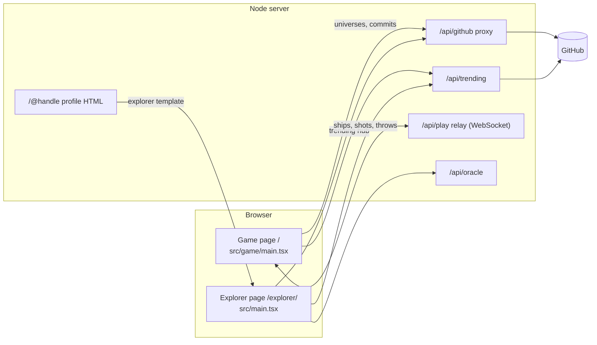

# 02 — Architecture

CodeVerse is one Vite application (`viewer/`) with two pages, a small Node server, and a separate
Python analyzer.



## Pages

| Page | Entry | Purpose |
|---|---|---|
| `/` | `index.html` → `src/game/main.tsx` | The game |
| `/explorer/` | `explorer/index.html` → `src/main.tsx` | The original explorer and local history viewer |
| `/@handle` | Server renders `explorer/index.html` with profile metadata | Shareable explorer profile links |

Both pages are separate Rollup inputs (`vite.config.ts`), so neither loads the other's code.

## Game modules (`src/game/`)

| File | Role |
|---|---|
| `sim.ts` | Pure simulation: universe creation, ships, aliens, bullets, planets, gate, supernova. No React, no three.js. Covered by `tests/orbitSim.test.mjs`. |
| `GameScene.tsx` | React Three Fiber scene. Reads the simulation every frame and draws it with instanced meshes, particles and sprites. Also the lobby's ship preview. |
| `OrbitGame.tsx` | UI: lobby, HUD, radar, dialogs, input, sound, networking glue. |
| `Tutorial.tsx` | First-flight lessons and the controls sheet. |
| `universe.ts` | Builds a universe from trending or a GitHub account. |
| `net.ts` | WebSocket client with reconnection backoff. |
| `game.css` | All game styles. |

The planets themselves are the explorer's shader worlds from `src/scene/World.tsx`, lit from the
central sun in the game.

### Frame flow

1. A driver component calls `step(sim, input, dt, events)` in `useFrame` with priority −1, before anything renders.
2. Scene components read the mutable simulation and update instance matrices directly, without React state.
3. Events (`shot`, `kill`, `commit`, `gate`, …) go to the UI for sound, toasts, tutorial progress and network messages.
4. The HUD and radar sample the simulation ten times a second into React state.

Keeping the simulation outside React keeps 60 fps updates out of React's render cycle and makes the
rules testable in plain Node.

## Server (`server/`)

| Module | Route | Notes |
|---|---|---|
| `trending.mjs` | `/api/trending` | Parses GitHub's monthly trending page; cached 30 minutes |
| `github.mjs` | `/api/github/*` | Optional proxy for public GitHub routes with caching and per-client caps |
| `oracle.mjs` | `/api/oracle` | Optional AI commit explanations |
| `profileHtml.mjs` | `/@handle` | Explorer page with per-profile share metadata |
| `og.mjs` | `/api/og` | Share images |
| `multiplayer.mjs` | `/api/play` | WebSocket relay; see [multiplayer.md](05-multiplayer.md) |
| `start.mjs` | — | Production server: static `dist/` plus everything above |

The same middlewares are mounted in Vite's dev and preview servers (`vite.config.ts`). On Vercel,
`api/*.mjs` functions expose the HTTP routes; the WebSocket relay is not available there.

## Design decisions

| Decision | Why | Trade-off |
|---|---|---|
| Client-side aliens | No game server to run or pay for; the relay stays stateless | Pilots in one universe fight different waves |
| Gate position from clock + room seed | Everyone agrees with no server state | Depends on roughly correct clocks |
| One relay process, rooms in memory | Simple, fast, no infrastructure | No horizontal scaling; restart drops rooms |
| Reusing the explorer's planet shaders | Strongest visuals already existed | Game and explorer share `src/scene/` |

## Repository layout

```
├── viewer/                  Web app (Vite + React + React Three Fiber)
│   ├── index.html           The game, served at /
│   ├── explorer/index.html  The explorer, served at /explorer/ and /@handle
│   ├── src/game/            Game: simulation, 3D scene, UI, tutorial, networking
│   ├── src/github/          GitHub client, planet styling, explorer UI
│   ├── src/scene/           Shared shader planets and sun
│   ├── server/              Node server: GitHub proxy, trending, Oracle, multiplayer relay
│   ├── api/                 Vercel serverless functions
│   └── tests/               node:test suites
├── analyzer/                Python package: Git history → JSON bundle
├── docs/                    Documentation and README images
├── game/                    Earlier single-file prototype (snapshot data, no multiplayer)
├── render.yaml              The relay as a Render service
└── .github/workflows/       CI and the relay keep-warm schedule
```
